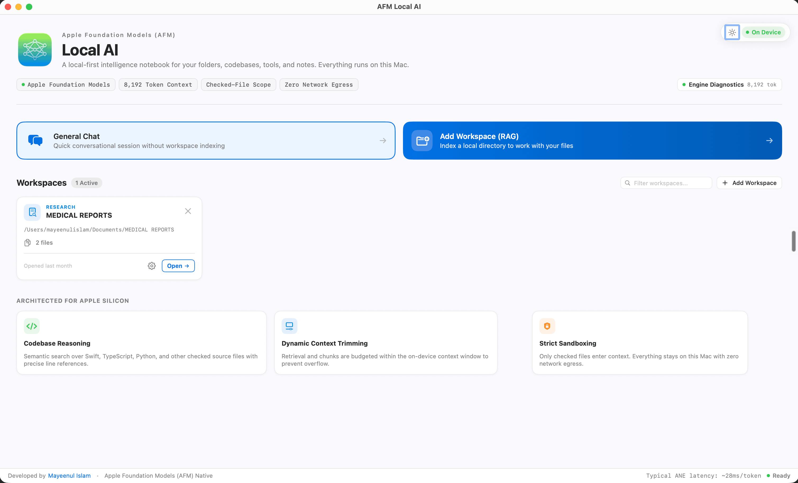
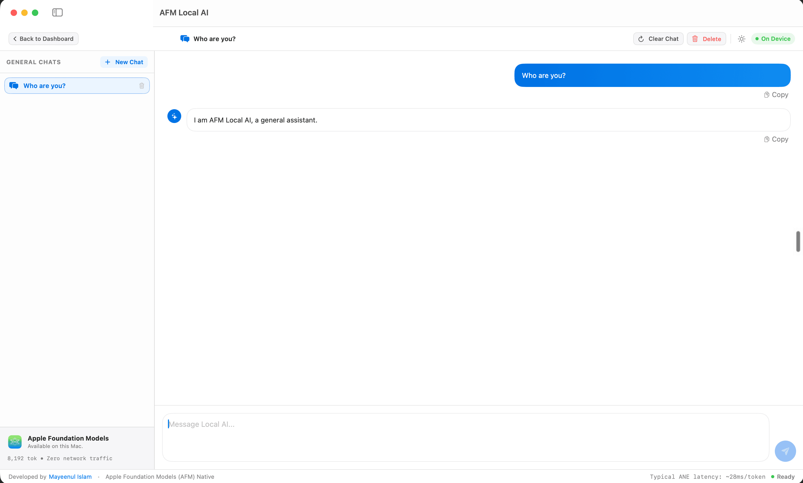
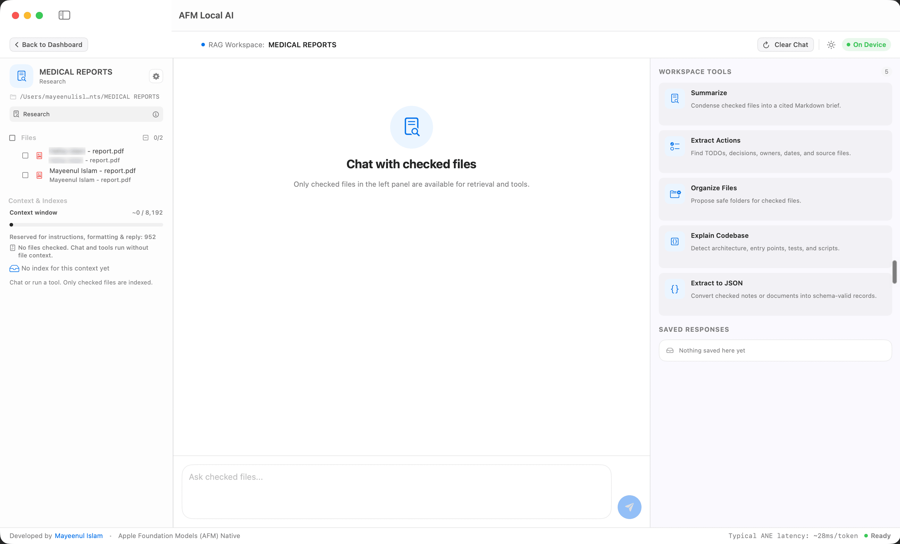

# AFM Local AI

AFM Local AI is a native, local-first macOS AI notebook. Open a local folder as your workspace, choose which files to include in context, and chat with an on-device model — all while keeping your data on your machine.

## Screenshots







## Requirements

- macOS 14+
- Apple Silicon Mac (recommended for Apple Foundation Models)
- Apple Intelligence enabled for on-device use (a built-in mock mode is available on unsupported Macs)

## Features

- **Dashboard** — Quick access to recent workspaces and chats
- **General Chat** — Multi-turn conversations with persistent history
- **Workspace Mode** — Open a local folder, select which files to include as context, and chat grounded in those files
- **Built-in Tools** — Summarize, Extract Actions, Organize Files, Explain Codebase, and Extract to JSON
- **Local-First** — Your files stay on your machine. No network connection required by default
- **Granular Permissions** — Control read/write/delete/shell/network access per workspace

## Build

```sh
swift build
```

## Run

```sh
swift run LocalAI
```

## Build a Development App

```sh
chmod +x scripts/build_dev.sh
scripts/build_dev.sh release
open "dist/AFM Local AI.app"
```

## Build a Distributable DMG

```sh
scripts/build_production.sh
```

The output will be created at `dist/AFM Local AI <version>.dmg`. Drag the app to `/Applications` to install.
